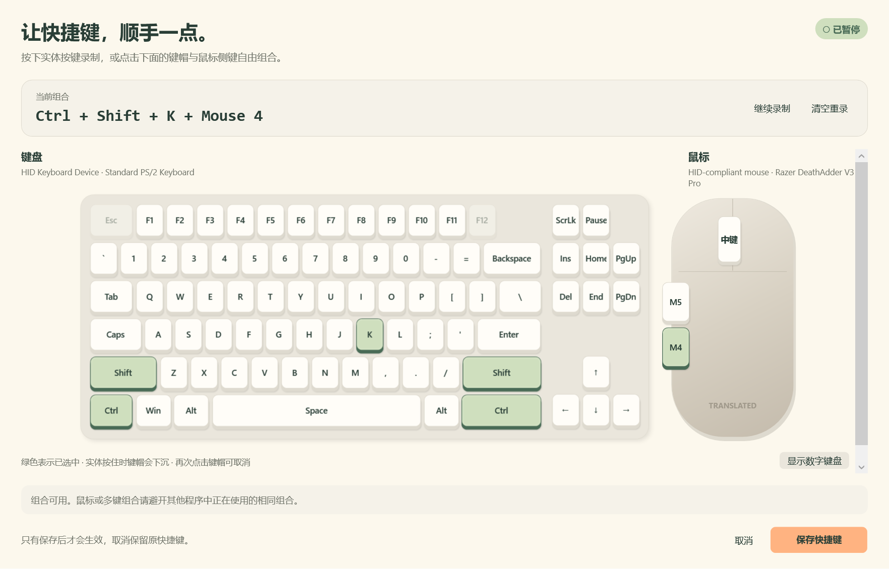

# Windows 自定义快捷键

## 使用

1. 打开 Translated → Settings → 自定义快捷键…。
2. 直接按下想使用的组合，或点击拟物键盘与鼠标上的按键。
3. 选中的键呈绿色，实体按住时键帽会下沉，松开后保留组合预览。
4. 可点击已选键取消、清空重录、暂停或继续录制。
5. 点击“保存快捷键”后立即生效，重启后仍保留。取消、Esc 或关闭窗口不会保存。

设置页仅显示当前快捷键，提供“自定义快捷键…”和 Reset；Reset 恢复 Ctrl+Shift+F8。原有修饰键按钮、Key 下拉框、Apply 和入口下方的说明文字已移除。

例如 Ctrl+Shift+K、Ctrl+Mouse 4、Mouse 5，以及 Ctrl+Shift+K+Mouse 4。

界面会读取 Windows 当前枚举到的键盘与鼠标名称，采用通用布局；不根据型号伪造精确外形，也不将组合绑定到某一台设备。左右同名修饰键保存为同一种逻辑修饰键。

## 支持范围

- 字母、数字、功能键、方向与编辑键、标点和数字键盘。
- Ctrl、Alt、Shift、Win 与最多四个普通键的组合。
- 鼠标中键、M4（XButton1）、M5（XButton2）；鼠标按键可单独使用或加入键盘组合。
- 键盘普通文字键必须搭配 Ctrl、Alt 或 Win，避免打字误触发；保留常用编辑及系统组合。
- Esc 用于取消；F12 为系统保留；不支持独立 Fn、滚轮滚动和未向 Windows 暴露的厂商宏键。
- 对无法独立读取的宏键，可先通过设备驱动映射为普通按键。

普通单键快捷键继续使用 RegisterHotKey，保存时检查系统注册冲突。多键/鼠标组合使用输入钩子，无法全面获知其他软件的私有绑定，因此不声称能检测所有冲突。

录制仅在弹窗处于前台时进行；切换应用会暂停，点击“继续录制”恢复。不会保存按键历史或输入文本。

推荐先按修饰键，再按普通键或鼠标侧键。完成组合的触发键会被拦截；未形成完整组合的前置按键仍可能执行原软件的行为。

## 配置与实现

仍使用原有 settings.json 中的 Hotkey，保留 Modifiers 和 Key，新增可选 AdditionalKeys。旧版配置不含新字段时按原样读取。保存失败时撤销候选注册并保留旧绑定；应用没有自动改写 API 服务设置或凭据。

| 文件 | 作用 |
| --- | --- |
| Windows/Core/Configuration.cs | 向后兼容的数据字段、比较与显示 |
| Windows/Core/ShortcutInput.cs | 键名、组合校验、去抖匹配与录制模型 |
| Windows/ShortcutHooks.cs | 独立消息线程上的键鼠钩子、录制作用域、触发键拦截及生命周期 |
| Windows/InputDevices.cs | Raw Input 设备枚举与可用友好名称 |
| Windows/InputWindow.cs | 与已有快捷键、输入版本和消息循环集成 |
| Windows/ShortcutEditor.xaml / .xaml.cs | 拟物选择器、实体录制、点亮、校验与保存 |
| Windows/Workspace.* | 设置页新入口与原快捷键界面的同步 |

当前仅实现 Windows 版本，macOS 保持原有快捷键界面。

## 验证

从仓库根目录运行：

~~~powershell
.\build-local.cmd
.\Windows\Tests\bin\Release\net48\Translated.Tests.exe --shortcuts
.\Windows\Tests\bin\Release\net48\Translated.Tests.exe --shortcut-keyboard
.\Windows\Tests\bin\Release\net48\Translated.Tests.exe --render .\BuildLogs\custom-shortcut-preview
~~~

核心检查包括旧配置兼容、混合组合序列化、保留组合、左右修饰键、完整组合、按住不连发、录制与选择混用、保存失败回滚。

独立桌面夹具验证键鼠混合触发、侧键拦截与正常透传、录制暂停、自定义与标准注册切换。--shortcut-keyboard 则通过实际桌面输入检查 Ctrl+Shift+J+K；少一个键不触发，松开后可再次触发。桌面检查使用临时窗口，不访问真实翻译 API。

需要人工检查录制及保存时可运行：

~~~powershell
.\Windows\Tests\bin\Release\net48\Translated.Tests.exe --shortcut-editor
~~~

该窗口使用临时偏好文件，退出后删除，不改动当前用户配置。

运行新构建产物前，先从托盘退出正在运行的 Translated；否则单实例机制只会唤起已有程序。主程序在 Windows/bin/Release/net48/Translated.exe，便携包在 dist/Translated-Windows.zip。

## 本次验证记录（2026-11-13）

- Release 构建成功，0 warning、0 error。
- 28 项核心检查全部通过。
- 15 项自动键鼠桌面检查通过。
- 通过真实桌面输入确认四键全局组合、未按全不触发、松开后重新触发。
- 通过临时设置弹窗确认键盘录制、键鼠混选和保存；取消时保留旧配置。
- 明暗主题、正常及最小尺寸渲染通过。
- 原有桌面套件的全局注册、选区读取、相同词不同位置、原生替换和只读判定通过；后续剪贴板快照检查因当前用户剪贴板含不支持完整备份的格式而中止。保留该保护规则，未清空用户剪贴板来强行完成测试。
- Windows 便携包已生成，并核对归档完整性与可执行文件内容。
